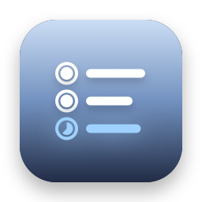
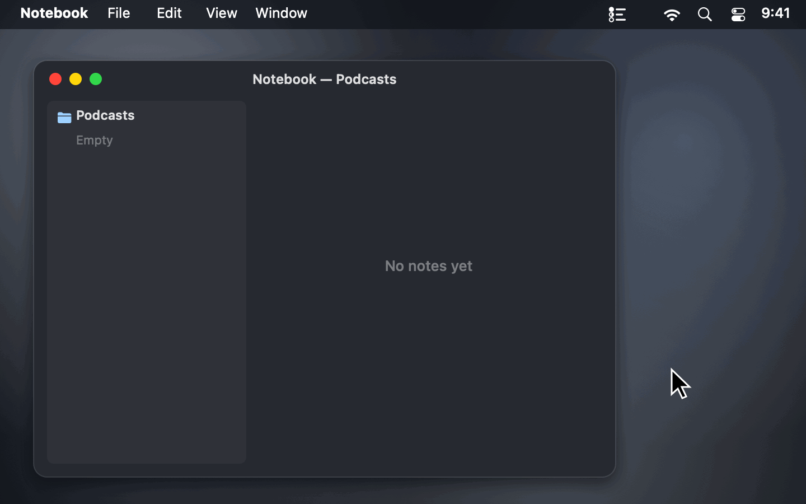
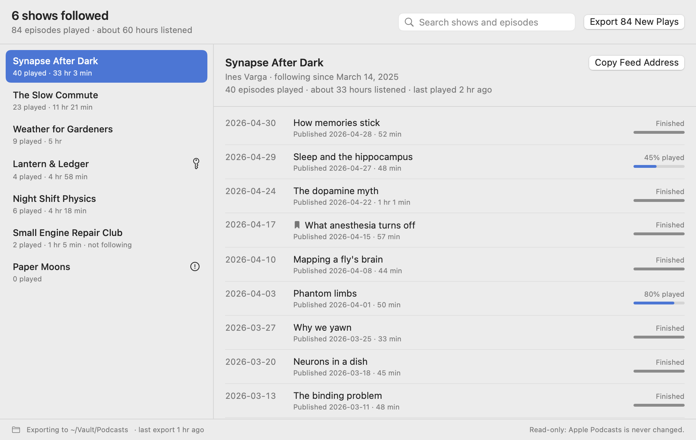
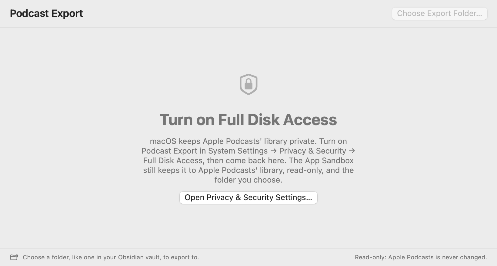

<p align="center">
  
</p>

<h1 align="center">Podcast Export</h1>

<p align="center">
  <b>Your Apple Podcasts shows as OPML, and your listening history.</b><br>
  A free, open-source menu bar app that exports the shows you follow as an OPML file any podcast app can import, plus every episode you've played as Markdown notes, CSV and JSON.
</p>

<p align="center">
  <a href="https://github.com/stanczykwyatt/podcast-export/releases/latest/download/Podcast-Export.zip"><b>Download for Mac</b></a>
  &nbsp;·&nbsp;
  <a href="https://stanczykwyatt.github.io/podcast-export/">Website</a>
  &nbsp;·&nbsp;
  <a href="https://github.com/users/stanczykwyatt/projects/1">Roadmap</a>
  &nbsp;·&nbsp;
  <a href="https://github.com/stanczykwyatt/podcast-export/discussions">Discussions</a>
</p>

<p align="center">
  <a href="https://github.com/stanczykwyatt/podcast-export/actions/workflows/ci.yml"></a>
  <a href="https://github.com/stanczykwyatt/podcast-export/releases/latest"></a>
  
  
  
  
  <a href="LICENSE"></a>
</p>

<p align="center">
  
</p>

---

Apple Podcasts on the Mac has no way to export your shows. There's no OPML file, the standard list of feeds that Overcast, Pocket Casts, Castro, AntennaPod and nearly every other podcast app can import, so switching apps means following every show again by hand. Your listening history doesn't come out at all. (Checked on macOS 15: Apple Podcasts' menus have no export, only Follow a Show by URL.)

Podcast Export fixes that. Choose **Save Subscriptions as OPML…** and you have a file to import anywhere. Or pick a folder, like one in your Obsidian vault, and it keeps that folder up to date with your subscriptions, an overview of every show with how much you've listened, a note for each show listing every episode you've played, and the whole history as a spreadsheet. Run it again and only what's new is added.

It also keeps history Apple Podcasts forgets. When you unfollow a show, Apple Podcasts can drop its episodes, and your record of listening to them goes too. Once Podcast Export has exported a play, it stays in the export.

It only reads Apple Podcasts, never changes it, and has no internet access. It's open source, so you can check exactly what it does.

If it saves you some retyping, [starring the repo](https://github.com/stanczykwyatt/podcast-export/stargazers) helps other people find it.

<picture>
  <source media="(prefers-color-scheme: dark)" srcset="docs/screenshot-dark.png">
  
</picture>

## Features

- **OPML for any podcast app.** The shows you follow, with their feeds, in the OPML 2.0 file other apps import. Save it once from the menu, or keep one in your export folder.
- **Your listening history,** as a note per show, an overview note, and `Listening History.csv` for spreadsheets. `Listening History.json` too, if you want it for scripts.
- **Stats for each show:** episodes played, roughly how long you've listened, when you started following it and when you last played it.
- **Only what's new on each run.** A small record in the export folder remembers what's there, so nothing is duplicated.
- **Never forgets a play,** even after Apple Podcasts does, and recognizes your library on a new Mac, so nothing is exported twice.
- **Never overwrites your edits.** Edit a note and it's left alone from then on. Files you didn't write are never touched; new ones get their own names.
- **Automatic export,** off until you turn it on.
- **Obsidian-friendly.** Front matter with properties and tags, and `[[links]]` from the overview to each show's note. Or standard Markdown links for any other app.
- **Search your shows and episodes** in a window that shows every episode you've played and how far you got.
- **A command line tool,** `podcast-export`, for scripts and Shortcuts.
- **Read-only and offline.** Free, with no account, subscription, tracking or dependencies.

### What a show's note looks like

```markdown
---
title: "Synapse After Dark"
author: "Ines Varga"
feed: "https://feeds.example.com/synapse.xml"
apple-podcasts: "https://podcasts.apple.com/podcast/id1000001"
following: true
following-since: 2025-03-14
episodes-played: 40
hours-listened: 33.1
last-played: 2026-04-30
source: Apple Podcasts
podcast-id: "SHOW-SYNAPSE"
tags:
  - podcast
---

# Synapse After Dark

By Ines Varga · following since March 14, 2025

40 episodes played · about 33 hours listened · last played April 30, 2026

## Played

- **2026-04-30** · How memories stick · 52 min · finished
- **2026-04-29** · Sleep and the hippocampus · 48 min · 45% played
```

The export folder ends up with `Podcasts.opml`, `Podcasts.md`, `Listening History.csv` and a `Shows` folder with one note per show.

### What it can't do

- **Apple Podcasts keeps one date per episode,** the last time you played it, not every listen. So the history has one line per episode, with that date and how far you got. "Hours listened" adds up the episodes you finished and how far you got in the rest, so it's an estimate.
- **Shows only Apple hosts can't move.** Some subscription shows have no public feed. They're listed in your notes, and left out of the OPML file, since no other app could follow them.
- **No show notes or transcripts.** Episode descriptions and Apple's transcripts belong to the shows that made them, so Podcast Export never reads them. You get titles, dates, progress and links.

## Install

1. [Download **Podcast-Export.zip**](https://github.com/stanczykwyatt/podcast-export/releases/latest/download/Podcast-Export.zip) and unzip it.
2. Move **Podcast Export** to your Applications folder and open it.
3. Turn on Full Disk Access when it asks: **System Settings → Privacy & Security → Full Disk Access**, then switch on Podcast Export. The window has a button that opens the right page.
4. Choose **Save Subscriptions as OPML…** or **Choose Export Folder…** from its menu bar icon.



> **Why Full Disk Access?** macOS keeps Apple Podcasts' library in a protected folder that no other app can read without it. Podcast Export's App Sandbox still limits it to that one folder, read-only, plus the export folder you choose. The rest of your disk stays out of reach even with Full Disk Access on. [SECURITY.md](SECURITY.md) has the details.

> **About the security warning:** The first time you open Podcast Export, macOS may say Apple couldn't verify that it's free of malware. It shows up because the app isn't notarized yet: Apple charges developers $99 a year for that, and this project hasn't paid the fee. The code is fully open source, so you can read every line or build the app yourself. To open it, go to **System Settings → Privacy & Security** and click **Open Anyway**.

> **Can't see the icon?** On a MacBook with a camera notch, menu bar icons that don't fit are hidden behind it. Hold ⌘ and drag the icon to the right, or quit a menu bar app you don't need.

### Build from source

You need macOS 14 or later and Swift 6, which comes with Xcode 16 or the Command Line Tools.

```bash
git clone https://github.com/stanczykwyatt/podcast-export.git
cd podcast-export
scripts/build-app.sh
open "build/Podcast Export.app"
```

That also builds the command line tool as `build/podcast-export`.

## How to use it

| To | Do this |
|---|---|
| Move your shows to another app | Menu → Save Subscriptions as OPML… (⌘S), then import the file there |
| Export what's new | Menu → Export New Plays (⌘E) |
| Export as you listen | Menu → Export Automatically |
| Find a show or episode | Menu → Open Podcast Export…, then type in the search field |
| Copy one show's feed | Open Podcast Export…, pick the show, Copy Feed Address |
| Choose what's written | Menu → Export Options: notes, CSV, JSON, link style |
| Change the export folder | Menu → Export Folder → Choose Another Folder… |
| Stop it opening at login | Menu → turn off Open at Login |

Shows only appear once Apple Podcasts on this Mac has them. If you listen on your iPhone, turn on syncing in Apple Podcasts' settings on both, so your shows and plays come to the Mac.

> **Keep `Podcasts.opml` to yourself if you have private feeds.** A show that comes with a paid membership often has a feed address with a personal key in it, and anyone with that address can listen as you. Podcast Export spots addresses like that, writes them only to the OPML file, and leaves them out of the notes, the history and its own record. The menu says when your OPML file holds one.

### The command line tool

```bash
podcast-export shows                        # shows you follow, with how much you've listened
podcast-export history --limit 20           # your latest plays
podcast-export opml > ~/Desktop/Podcasts.opml
podcast-export export ~/Notes/Podcasts --json
```

`podcast-export --help` lists every option. It needs Full Disk Access for your terminal app, and like the app, it only reads Apple Podcasts and only writes into the folder you give it.

## Privacy and security

Podcast Export is built so it *can't* misuse your library, not just so it promises not to.

- **Read-only.** The App Sandbox gives it read access to the Apple Podcasts library and nothing else in your home folder, and blocks writing there. It never opens Apple Podcasts' database directly: it reads a copy in its own temporary folder, so it can't disturb Apple Podcasts even by accident.
- **Writes only where you say.** The one folder you choose, or the one file you save, through the standard macOS dialogs. Files that are already there are never overwritten, and it never deletes anything.
- **No internet access.** The app has no network entitlement, so it can't send anything anywhere, and it never fetches a feed. CI checks every build for this.
- **Private feeds stay in one file,** the OPML you asked for.
- **No dependencies.** Every line that runs is in this repository.

Check the app's permissions yourself with `codesign -d --entitlements - "/Applications/Podcast Export.app"`. The full details are in [SECURITY.md](SECURITY.md).

## FAQ

**How do I export my Apple Podcasts subscriptions as OPML?**
Apple Podcasts on the Mac doesn't have an export. Open Podcast Export, choose Save Subscriptions as OPML… from its menu bar icon, and save the file. Then import it in your new podcast app, usually under Settings or Import.

**Can I see my Apple Podcasts listening history?**
Yes. The window lists every episode you've played, by show, with the day you last played it and how far you got. Export it to get a note for each show and a spreadsheet of every play.

**Can I move from Apple Podcasts to Overcast, Pocket Casts or AntennaPod?**
Yes. All of them import OPML. Your history doesn't move into them, since none of them import it, but you keep it in your notes and the CSV.

**Why is a show missing from the OPML file?**
Either you don't follow it (Apple Podcasts adds shows you only played to your library without following them), or it has no public feed, like some shows only Apple hosts. The menu, the window and the command line tool say which shows were left out.

**Will it change or delete anything in Apple Podcasts?**
No. The App Sandbox only lets it read Apple Podcasts' folder, and it reads a copy of the database rather than the database itself. Unfollowing a show in Apple Podcasts doesn't delete anything from the export either.

**Can I edit the notes it makes?**
Yes. A file you've changed is never overwritten. Podcast Export only updates files it made that you haven't touched. Delete a show's note and it stays deleted; delete `Podcasts.opml` or the history and the next export writes them fresh.

**What are `.podcast-export.json` and `.podcast-export.lock`?**
The first is Podcast Export's record of what it has exported to the folder: every show and play so far, without private feed addresses, and what each file held when it was written. It's how history Apple Podcasts forgets stays in the export, so keep it with the folder. The second is empty and keeps two exports into the same folder from running at once. Both are hidden.

**Does it work on Intel Macs?**
Yes. The download runs on Apple silicon and Intel Macs with macOS 14 Sonoma or later.

## More free Mac utilities

- **[Show Desktop](https://github.com/stanczykwyatt/show-desktop):** hide every window with one click or ⌃⇧D, then bring them all back exactly as they were.
- **[Copy 2FA](https://github.com/stanczykwyatt/copy-2fa):** copy 2FA codes from Mail, Messages or a built-in authenticator with one keyboard shortcut.
- **[Who Stole My Focus](https://github.com/stanczykwyatt/who-stole-my-focus):** find out which app keeps jumping in front of your work.
- **[AI Footprint](https://github.com/stanczykwyatt/ai-footprint):** see what AI coding tools leave on your Mac, and what each update changed.
- **[Memo Export](https://github.com/stanczykwyatt/memo-export):** export your Voice Memos transcripts as Markdown, with the audio.

All six have no internet access.

## Contributing

Contributions are welcome, especially reports of shows or episodes it read wrong, and podcast apps whose import doesn't take the OPML file. See [CONTRIBUTING.md](CONTRIBUTING.md), and the [roadmap](https://github.com/users/stanczykwyatt/projects/1) for what's planned. Ideas go in [Discussions](https://github.com/stanczykwyatt/podcast-export/discussions).

## License

Podcast Export is released under the [MIT License](LICENSE) and is provided as is, without warranty of any kind.

Podcast Export is an independent project. It isn't affiliated with, endorsed by or sponsored by Apple Inc., Obsidian, or the makers of any podcast app named here. Apple, Mac, macOS, iPhone and iCloud are trademarks of Apple Inc., registered in the U.S. and other countries. Apple Podcasts is an app made by Apple. Other product names belong to their owners and are used only to say what the app works with. The shows, episodes and notes app in the screenshots and demo are made up.
